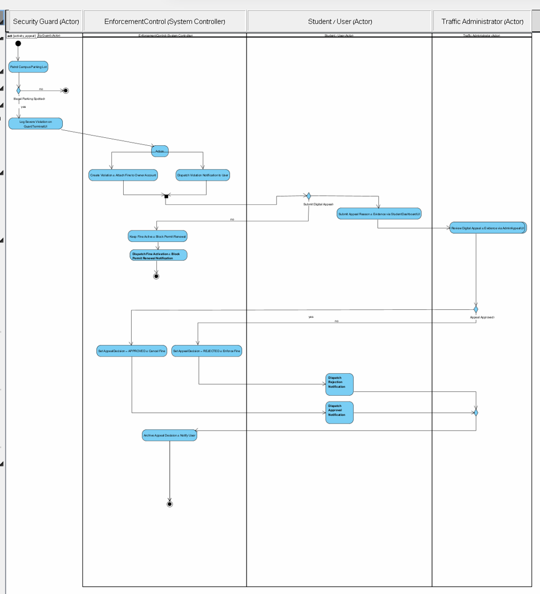
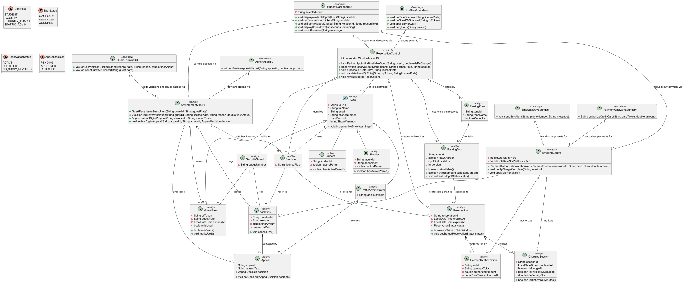
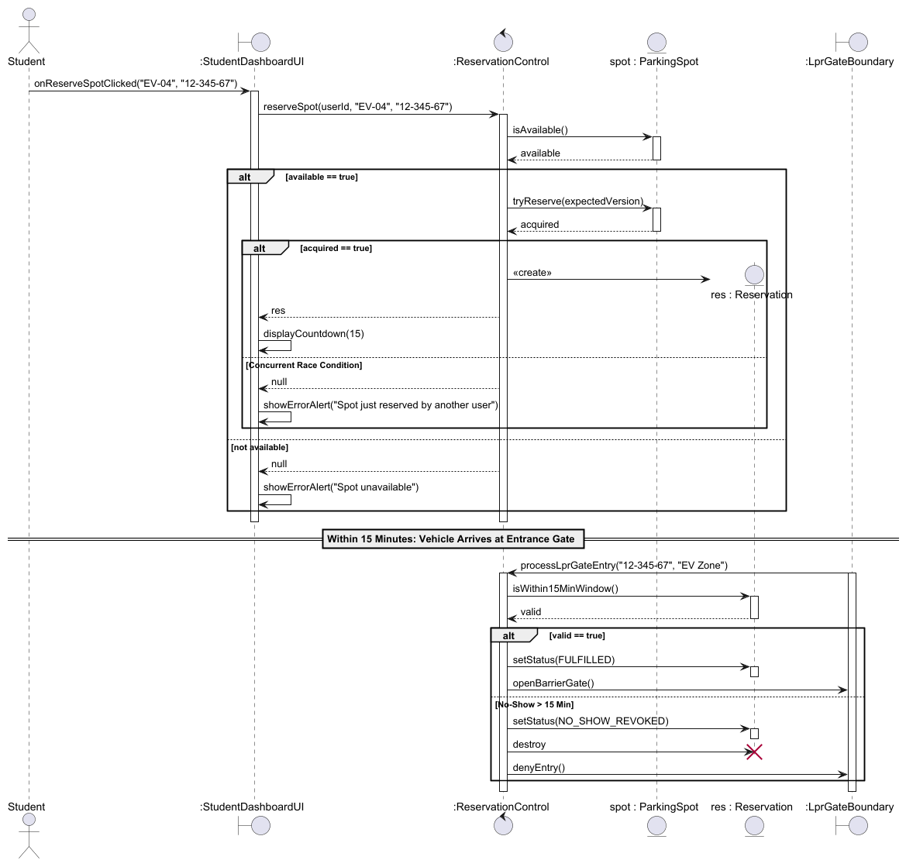
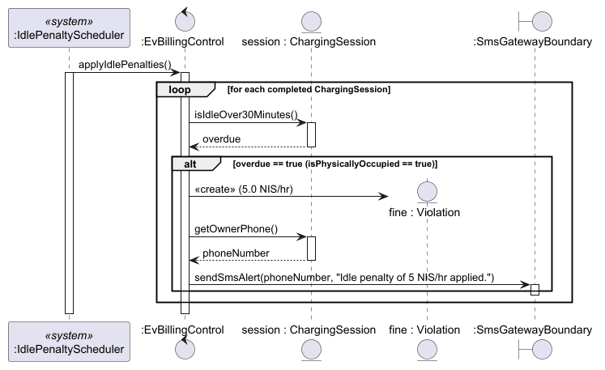

# System Architecture & Object-Oriented Design (`Ex4_SmartParking_Design`)

**Course:** 61756 Software Engineering Methods (Academic Year 2026-2027)
**Institution:** ORT Braude College of Engineering | Department of Software Engineering
**Domain:** Smart Campus Parking, LPR, and EV Network (Continued from Exercise 1)

---

## 1. Engineering Team Details

| Role | Full Name | Student ID | Braude Academic Email |
| :--- | :--- | :--- | :--- |
| **Student A (Role A)** | `Shahar Reichman` | `הזן_תז_שחר` | `Shahar.Reichman@e.braude.ac.il` |
| **Student B (Role B)** | `Amir Kosover` | `הזן_תז_אמיר` | `Amir.Kosover@e.braude.ac.il` |

* **Group Number:** `GXX`
* **GitHub Repository URL:** `https://github.com/AmirKosover/Ex4_SmartParking_Design1`

---

## 2. Step 1: Business Process Modeling — Activity Diagram (`Visual Paradigm`)

* **PlantUML Source:** [`diagrams/activity_appeal.puml`](diagrams/activity_appeal.puml)
* **Visual Paradigm Model:** [`SystemModel_Ex4.vpp`](SystemModel_Ex4.vpp)
* **Partitions / Swimlanes:** Separates external **Actors** (`Security Guard`, `Student / User`, `Traffic Administrator`) from the internal **System Controller** (`EnforcementControl`), using `initial node`, `fork`/`join` (AND), `decision` (XOR) with explicit `[guards]`, `merge` (OR), and `activity final node`.



---

## 3. Step 2: Structural Modeling — ECB Class Diagram (`PlantUML` -> `Visual Paradigm`)

Following the **ECB (Entity-Control-Boundary)** architectural pattern:

| ECB Stereotype | Classes in System | Architectural Responsibility |
| :--- | :--- | :--- |
| **`<<boundary>>`** | `StudentDashboardUI`, `GuardTerminalUI`, `AdminAppealUI`, `LprGateBoundary`, `PaymentGatewayBoundary`, `SmsGatewayBoundary` | Interfaces with external Actors and external hardware/payment/SMS systems. Communicates ONLY with `<<control>>` classes. |
| **`<<control>>`** | `ReservationControl`, `EvBillingControl`, `EnforcementControl` | Multiple specialized controllers orchestrating business rules, timers, concurrency checks, and workflows. |
| **`<<entity>>`** | `User` (`Student`, `Faculty`, `SecurityGuard`, `TrafficAdministrator`), `GuestPass`, `Vehicle`, `ParkingZone`, `ParkingSpot`, `Reservation`, `PaymentAuthorization`, `ChargingSession`, `Violation`, `Appeal` + 4 UML `enum`s | Passive domain data classes storing persistent business state and domain helper methods. |

* **PlantUML Source:** [`diagrams/class_diagram_ecb.puml`](diagrams/class_diagram_ecb.puml)
* **Visual Paradigm Model:** [`SystemModel_Ex4.vpp`](SystemModel_Ex4.vpp)



---

## 4. Step 3: Behavioral Modeling — ECB Sequence Diagrams (`PlantUML` -> `Visual Paradigm`)

### 4.1 Sequence Diagram 1: Spot Reservation, LPR Gate Entry & No-Show Destruction
* **PlantUML Source:** [`diagrams/sequence_reservation_ecb.puml`](diagrams/sequence_reservation_ecb.puml)



### 4.2 Sequence Diagram 2: EV Charging 30-Minute Idle Penalty (`loop` & `<<create>>`)
* **PlantUML Source:** [`diagrams/sequence_idle_penalty_ecb.puml`](diagrams/sequence_idle_penalty_ecb.puml)



---

## 5. Independent AI Prompt & Architectural Design Critique (Part 4)

```text
Audit our attached ECB Class Diagram (class_diagram_ecb.puml) and Reservation Sequence Diagram (sequence_reservation_ecb.puml) against the edge cases defined in Section 3 of SYSTEM_STORY.md:
1. Simultaneous Double-Booking Race Condition: Verify how two students attempting to reserve the last available spot in Student Zone at the exact same millisecond are serialized so only one reservation succeeds.
2. Physical Bay Occupancy vs. Electrical Cable Disconnection: Verify that if an EV driver unplugs the charging cable at minute 29 without physically vacating the EV bay, the 30-minute Charger Idle Penalty (5 NIS/hr) is still triggered.
Identify any missing attributes, methods, or alternative branches needed to enforce strict consistency across both diagrams.